# Production architecture

Reviewed October 24, 2026, against the October production release and retained evidence described in the [status register](PUBLIC_PROOF_RELEASE.md). This is a component-level explanation, not a public production schema or deployment recipe.

[Editable Mermaid source](../assets/diagrams/production-architecture.mmd). This SVG and source are the single canonical diagram reused by the README.

## Structured evidence and durable work

TradingView supplies structured observations. Ingress authenticates and validates input before accepting it into durable storage. For XSP, the approved market authority is AMEX:SPY confirmed five-minute bars; screenshot interpretation and another exchange feed cannot substitute for that authority. Freshness alone does not establish continuity. A valid recent observation can coexist with an earlier missing bar.

Source persistence, downstream job custody, evaluation, and notification are separate boundaries. Bounded native workers own downstream processing; a source record alone does not prove that a job was admitted or completed. SQLite write contention can still prevent admission. External provider I/O is kept outside the inspected write transactions, while narrow transactions and targeted indexes reduce contention without eliminating it.

Stock forward reconciliation examines already-persisted sources for exact downstream custody or an explicit disposition. The recovery path is audit-only: it does not create historical entries, acquire historical contracts, call providers, or deliver old alerts. This boundary is intentionally separate from normal live work. See the [reliability case study](PRODUCTION_RELIABILITY.md).

## Two deterministic workflows

**XSP:** approved evidence → qualification → selected contract and reference quote → economic/lifecycle monitoring → terminal reconciliation → setup ownership release. Later evidence must match the correct lifecycle. A later generation requires independent qualification and session-policy permission; terminal work cannot be resurrected. [Walkthrough](DEMO_WALKTHROUGH.md).

**Stock Scout:** readiness → frozen Anchor → advisory ranking → native membership validation and activation → authorized option research → persisted contract monitoring → terminal handling. Ranking proposals cannot expand the frozen pool or grant execution authority. Attribution of AI participation is specific to each run. [Walkthrough](STOCK_SCOUT_WALKTHROUGH.md).

## Notifications and uncertainty

Durable notification intents precede delivery. Conditional ownership claims, identity checks, sequencing checks, and terminal-state guards constrain which worker may act. Provider acknowledgement records a provider outcome, not device display or human attention. A timeout after a possible send is uncertain; it must not become permission for blind replay. These controls support bounded recovery, not a universal exactly-once delivery guarantee.

The [public reference](../reference/README.md) independently illustrates a subset of these patterns with generic events. Its schema and state machine are educational, not extracted production implementation.

## Authority map

| Component | Responsibility | Boundary |
| --- | --- | --- |
| Ingress and source validation | Authenticate, validate, persist approved evidence | Rejected or unpersisted requests cannot be assumed recoverable |
| Native decision and research services | Enforce qualification, membership, lifecycle, economics, and terminal state | AI proposals cannot bypass native gates |
| AI and operator ranking workflow | Propose a bounded selection or summarize context | Model participation is attributed per run; native acceptance remains required |
| Durable workers and outbox | Establish custody, conditional ownership, sequencing, and outcome records | An intent is not delivery; uncertainty requires disposition |
| Operator interface and Telegram | Present state and communicate permitted outcomes | Neither surface grants trading authority |
| Human operator | Independently decide whether to trade | Any trading action occurs outside these workflows |
| Broker and options execution | No active product path | Disabled |

Release verification and [bounded observability](OBSERVABILITY.md) apply across the diagram. Installation evidence, regression tests, and natural runtime acceptance remain distinct. Exact predicates, timing windows, identities, ranking weights, endpoints, and private schemas are omitted.
